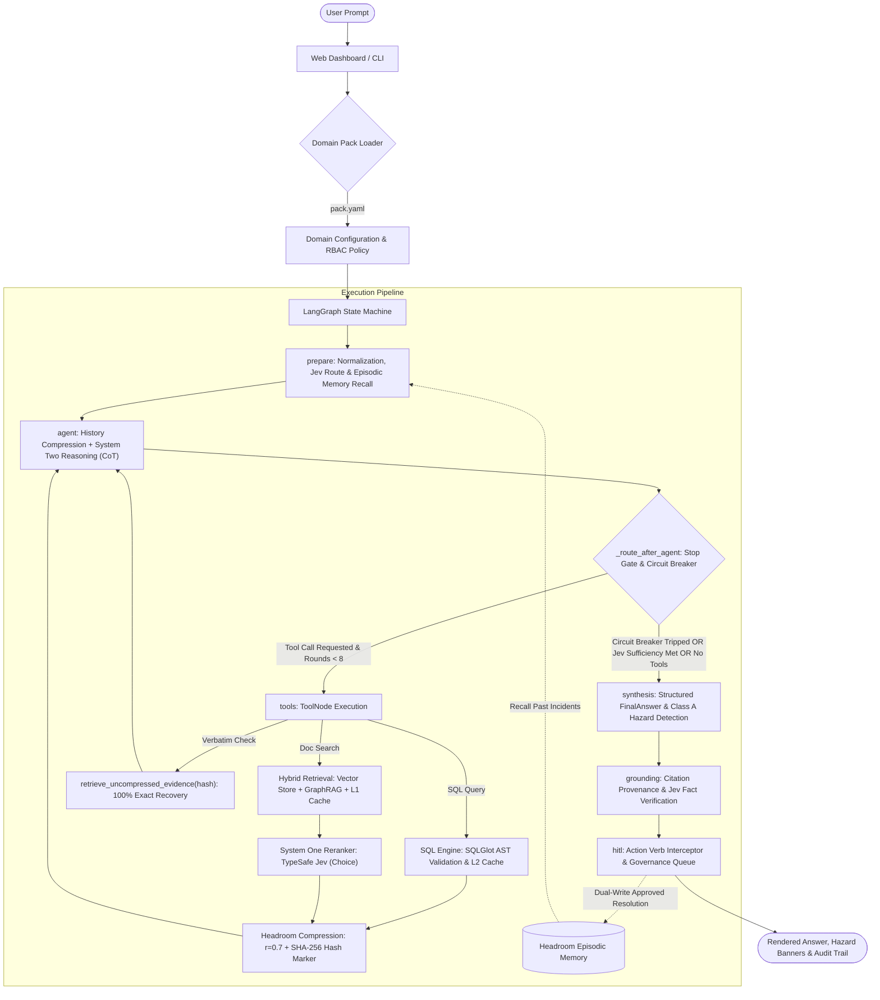

# Enterprise Agentic Decision Support Framework
### Flagship Benchmark: Apex Automotive — Northgate Assembly Plant (NGA)

> **⚠️ Disclaimer — Synthetic Evaluation Corpus**:  
> All data in this repository — including **Apex Automotive**, the **Northgate Assembly Plant (NGA)**, vehicle models (*Aurora AU-2025*, *Solstice SO-2025*), Standard Operating Procedures (SOPs), machine specifications, fault codes, non-conformance records, torque logs, SQLite database tables (`nga.db`), and the banking demonstration data (`banking.db`) — is **entirely synthetic and fictional**. It has been generated strictly for research, testing, and AI decision-support benchmark evaluation purposes.

---

The **Enterprise Agentic Decision Support Framework** is an extensible, production-grade, role-aware agentic platform engineered for mission-critical industrial decision support. It decouples high-assurance AI governance, deterministic retrieval-grounding, and state-machine orchestration from any single business vertical via **Declarative Domain Packs**.

The repository contains:
1. **Generic Enterprise Agent Engine (`src/enterprise_agent/`)**: The canonical domain-agnostic library comprising:
   - `config`: Declarative domain pack configuration, schema validation, and evaluation criteria (`DomainConfig`).
   - `database`: SQLite engine with AST-validated read-only text-to-SQL execution via SQLGlot (`SqliteAdapter`).
   - `documents`: Multi-format document ingestion pipeline (`DocumentIngestionPipeline`) parsing Markdown, JSON, CSV, and Plain Text with path-based RBAC clearance tagging.
   - `rag`: Vector store ingestion and generic retrieval tools (`make_generic_retrieval_tool`).
   - `retrieval` / `models`: System One semantic reranking via TypeSafe AI Jev (`Choice` primitive) and structured answer models.
   - `tools`: Dynamic tool factory for SQL and document retrieval (`make_generic_sql_tool`, `make_generic_retrieval_tool`).
   - `graph`: Domain-adaptive LangGraph state machine orchestration and HITL policy gates (`build_enterprise_agent_graph`).
   - `cache`: SQLite-backed multi-tier caching (`EnterpriseCache`, `CachedEmbeddings`, `cached_run_query`, `cached_retrieve`).
   - `compression`: Headroom context compression and session raw store.
   - `evaluation`: Deterministic grounding verification (`grounding.py`), DeepEval adapter (`deepeval_adapter.py`), custom domain metrics (`deepeval_metrics.py`), TypeSafe Jev judge (`judge.py`), side-by-side benchmarking (`side_by_side.py`), and CI trend tracking.
   - `memory`: Episodic semantic memory, decision logs, and SQLite checkpointers.
   - `tracing`: OpenTelemetry tracing instrumentation.
   - `ui`: Domain-adaptive FastAPI server and web dashboard.
2. **Flagship Domain: NGA Manufacturing Assistant (`src/nga/`)**: Specialized automotive manufacturing assistant tailored for the synthetic **Apex Automotive — Northgate Assembly Plant (NGA)**, maintaining **backward-compatibility shims** that re-export canonical `enterprise_agent` components alongside manufacturing-specific GraphRAG builders, assets, and seed database (`nga.db`).
3. **Banking Domain Pack (`domains/banking/`)**: A financial crime and AML/sanctions compliance decision support pack demonstrating domain portability across banking policies, SAR filings, and OFAC watchlists.
4. **Deterministic Evaluation & Grounding Suite**: 4-tier stepped benchmark suites (85 questions), quantitative Graph Quality metrics, A/B release gates, multi-model Pareto arena, citation existence & retrieval provenance verification, **TypeSafe AI Jev** calibrated System One scoring, and **Headroom multi-hop long reasoning chain benchmarks**.

---

## 🛠️ Technology Stack & Rationale

| Technology | Selected Component | Why This Stack Was Chosen |
|---|---|---|
| **Orchestration** | **LangGraph** | Provides a state-machine framework defining deterministic, predictable paths (`prepare` → `agent` ⇆ `tools` → `synthesis` → `hitl`). Guarantees that governance, circuit breakers, and safety verification execute in order. |
| **Vector DB** | **ChromaDB** | Lightweight, persistent vector store supporting exact metadata filtering. Enforces path-derived RBAC constraints (`level_rank <= user_level`) directly during similarity search. |
| **Knowledge Graph** | **NetworkX** | Python-native graph library persisting extracted manufacturing entities and relations (e.g., `Machine`, `FaultCode`, `RecallCriteria`) for GraphRAG multi-hop BFS reasoning. |
| **System One Reranker** | **TypeSafe AI Jev** (`typesafe-ai/jev`) | Sub-30ms System One `Choice` reranker evaluating candidate passage relevance against query context in a single forward pass, replacing heavy GPU cross-encoders with zero GPU infrastructure. |
| **Context Compression & Memory** | **Headroom AI** (`headroom-ai`) | Session-isolated context compression for RAG tool outputs and multi-turn message history with deterministic SHA-256 hash markers, 100% byte-for-byte uncompressed evidence recovery, and episodic plant incident memory. |
| **Security & SQL Engine** | **SQLGlot** | Strict SQL AST parser and validator. Validates generated text-to-SQL commands prior to execution, restricting queries strictly to single, read-only `SELECT` statements matching the live database schema. |
| **Fast Evaluation Judge** | **TypeSafe AI Jev** | System One non-generative decision model using Reinforcement Learning for Calibrated Decisions (RLCD). Evaluates groundedness and correctness in sub-50ms with zero token generation cost. |
| **Package Manager** | **uv / hatchling** | Modern, reproducible Python package installer and workspace manager with locked dependencies. |
| **Testing** | **pytest** | Full automated test suite covering unit APIs, integration benchmarks, stress tests, and deterministic grounding checks. |

---

## 📐 System Architecture



---

## 🏢 Generic Enterprise Agentic Framework (`src/enterprise_agent/`)

The framework is decoupled into domain-agnostic components configured declaratively via YAML domain packs:

```
domains/
├── manufacturing/
│   └── pack.yaml             # Apex Automotive NGA configuration
└── banking/
    ├── pack.yaml             # Global Horizon Bank AML configuration
    └── init_db.py            # SQLite seed script for banking transactions
```

### Domain Pack Architecture (`pack.yaml`)
Each domain pack defines:
- **`domain`**: Unique identifier, title, description, and version.
- **`rbac`**: Hierarchy of roles (e.g. `operator: 1` to `manager: 4`), tailored role system prompts, and folder-path security classification rules.
- **`database`**: SQLite connection URI, tool registration name/description, and an explicit whitelist of `allowed_tables`.
- **`documents`**: Document search tool configuration, supported file extensions (`.md`, `.json`, `.csv`, `.txt`), category definitions, document ID regex patterns, and excluded files.
- **`governance`**: High-consequence action verbs triggering Human-in-the-Loop review (e.g. `stop-ship`, `quarantine`, `freeze account`, `file sar`), critical safety/compliance terms, and escalation levels.

### Multi-Format Document Ingestion
The generic document loader (`src/enterprise_agent/documents/loader.py`) parses and ingests:
- **Markdown (`.md`)**: Extracts YAML frontmatter, headings, sections, and embedded document IDs.
- **JSON (`.json`)**: Recursively flattens structured records into searchable textual chunks.
- **CSV (`.csv`)**: Formats tabular data with header-aware row annotations.
- **Plain Text (`.txt`)**: Paragraph and sliding-window chunking.

---

## 🎯 System One Document Reranking (TypeSafe Jev)

To enhance retrieval precision beyond pure dense vector embeddings, the framework integrates a **System One Jev Reranker** (`src/enterprise_agent/retrieval/reranker.py`):
1. **Initial Retrieval**: Retrieves candidate chunks from ChromaDB and the GraphRAG knowledge graph across document categories.
2. **Jev Choice Evaluation**: Submits all candidate chunks as options in a single TypeSafe `Choice` call (`typesafe-ai/jev`), evaluating semantic relevance in sub-30ms with zero token generation cost.
3. **Calibrated Probability Ranking**: Sorts documents by the model's calibrated probability distribution and selects the top $N$ (default: 5) most authoritative passages for downstream synthesis.

---

## 🗜️ Context Compression & Episodic Memory (Headroom Integration)

Industrial manufacturing workflows frequently trigger multi-hop reasoning chains involving verbose database tables (e.g., hundreds of torque records across assembly shifts) and extensive standard operating procedures. Unchecked, raw context rapidly exhausts LLM context windows, inflates latency, and degrades reasoning precision.

The framework integrates **Headroom AI (`headroom-ai`)** using an explicit node-level context optimization pattern (**Approach B**) coupled with episodic semantic memory (`src/enterprise_agent/compression/` and `src/enterprise_agent/memory/`, with `src/nga/` backward-compatibility shims):

### 1. Dual-Scope Context Compression
- **Tool Payload Compression**: When tools (`query_nga_database`, `query_banking_database`, `search_sop_documents`) return outputs exceeding the threshold (`min_tokens=250`), Headroom compresses the textual payload targeting ratio $r=0.7$ (a conservative 30% reduction calibrated to protect technical parameters, part numbers, and error codes).
- **Multi-Turn History Compression**: Prior to invoking the System Two LLM in `agent_node`, prior conversation turns are compressed with `protect_recent=2`, preserving immediate operational context while eliminating context bloat from earlier turns.
- **Session-Scoped In-Memory Raw Store**: Uncompressed payloads are cached strictly in-memory per session (`SessionRawContentStore`) with LRU eviction and zero cross-tenant leakage.

### 2. The Verbatim Grounding Guarantee
In high-precision manufacturing, rounding errors or missed tolerances are unacceptable (e.g., bolt torque tolerances `48.5 Nm ± 1.5 Nm`). The system enforces a **Dual Representation Pattern**:
- Every compressed payload is tagged with a deterministic hash: `[hash=8f1c3a]`.
- The agent is equipped with the `retrieve_uncompressed_evidence(evidence_hash)` tool.
- If the agent evaluates a safety-critical **Class A defect** or requires exact verification before a stop-ship recommendation, it retrieves the original text byte-for-byte from the in-memory store.

### 3. Cache Coexistence & Layer Architecture
Headroom operates strictly downstream of the multi-tier input/execution cache (`src/enterprise_agent/cache/`, re-exported via `src/nga/cache`):
- **L0 (Embedding), L1 (Retrieval), and L2 (SQL)** caches in `data/cache.db` prevent redundant searches and expensive database operations.
- **Headroom** optimizes the prompt payload size passed into the LLM context window.
- Invalidation of `data/cache.db` does not disrupt session-scoped Headroom hashes, and Headroom respects all RBAC level isolation.

### 4. Episodic Semantic Memory (`NgaEpisodicMemory`)
- **Past Incident Recall**: During query preparation (`prepare_node`), the agent queries `data/headroom_memory.db` for semantically similar past plant incidents, presenting historical resolutions and root-cause analyses directly in the agent's system prompt.
- **HITL Dual-Write**: Whenever an operator or plant manager approves a critical recommendation in the Human-in-the-Loop gate, the resolution is dual-written to `NgaEpisodicMemory` alongside the structured audit log in `app_state.db`.

### 5. Multi-Hop Long Reasoning Benchmark Results
Evaluated on long reasoning chains simulating complex multi-station audits and safety escalations (`tests/benchmarks/test_long_reasoning_benchmark.py`):
- **LR1 (Station 144 Torque Drift & Recall Trace)**: Raw 6,644 chars $\to$ 1,878 chars (**71.7% token reduction**).
- **LR2 (Assembly Lines 1 & 2 Breadth Audit)**: Raw 6,600 chars $\to$ 1,878 chars (**71.5% token reduction**).
- **LR3 (Dual Safety Defect Regulatory Escalation)**: Raw 6,550 chars $\to$ 2,071 chars (**68.4% token reduction**).
- **Verbatim Recovery**: **100% exact match** on all tolerance specifications via hash retrieval.

## 🛡️ Human-in-the-Loop (HITL) Safety & Governance

High-consequence operational decisions cannot be executed autonomously. The governance policy gate (`src/enterprise_agent/hitl/policy_gate.py` and `src/nga/hitl/`):
- **Action Verb Interception**: Detects mandatory approval verbs (e.g., `stop-ship`, `quarantine`, `recall`, `freeze account`, `file sar`).
- **Audit Logging**: Logs pending actions to `app_state.db` under `decisions_log`.
- **Mandatory Approver Identification**: Enforces approver credentials and engineering/compliance justification for critical actions before authorization.

---

## 🚀 Getting Started & Setup

### 1. Prerequisites
Ensure you have `uv` installed:
```bash
curl -LsSf https://astral.sh/uv/install.sh | sh
```

### 2. Environment Configuration
Copy the `.env.example` template to `.env`:
```bash
cp .env.example .env
```

Configure your credentials in `.env`:
```ini
# OpenRouter API Key for Cloud execution
OPENROUTER_API_KEY=your-openrouter-api-key
OPENROUTER_MODEL=anthropic/claude-sonnet-4-5

# TypeSafe AI API Key (for System One Jev Reranking & Judge)
TYPESAFE_API_KEY=your-typesafe-api-key
RERANK_ENABLED=true
RERANK_MODEL=jev-1.12
RERANK_TOP_N=5

# Active Domain Pack
DOMAIN_PACK=domains/manufacturing/pack.yaml

# Headroom AI (Context Compression & Episodic Semantic Memory)
HEADROOM_ENABLED=true
HEADROOM_COMPRESSION_ENABLED=true
HEADROOM_MEMORY_ENABLED=true
HEADROOM_COMPRESSION_RATIO=0.7
HEADROOM_MIN_TOKENS_TO_COMPRESS=250
HEADROOM_MEMORY_TOP_K=3

# OpenTelemetry Tracing (Optional)
OTEL_TRACING_ENABLED=false
OTEL_SERVICE_NAME=nga-manufacturing-assistant
OTEL_EXPORTER_OTLP_ENDPOINT=http://localhost:4317
OTEL_TRACES_EXPORTER=otlp
```

### 3. Install Dependencies
```bash
uv sync
```

### 4. Ingest Corpus & Build Knowledge Graph
Build the Chroma vector store and the GraphRAG knowledge graph for the manufacturing domain:
```bash
# Ingest all SOPs and specs with RBAC metadata
uv run python -m nga.ingestion.build_vector_store

# Extract entity-relation graph for GraphRAG (with TypeSafe AI alignment & ontology sanitization)
uv run python -m nga.ingestion.build_graph

# (Optional) Re-run standalone entity alignment or graph quality evaluation
uv run python scripts/align_graph.py
uv run python -c "from nga.ingestion.build_graph import load_graph; from nga.evaluation.graph_eval import evaluate_graph_quality; evaluate_graph_quality(load_graph('data/graph_store'))"
```

*(Optional) Seed the banking demonstration database:*
```bash
uv run python domains/banking/init_db.py
```

### 5. Launch the Web User Interface (Recommended)
Launch the domain-adaptive operations dashboard with any vertical domain pack:
```bash
# Launch with Banking AML domain pack via CLI argument
uv run python -m enterprise_agent.ui.runner --domain domains/banking/pack.yaml --port 8000 --host 127.0.0.1 --open-browser

# Or launch with Banking AML domain pack via environment variable
DOMAIN_PACK=domains/banking/pack.yaml uv run python -m enterprise_agent.ui.runner --port 8000 --host 127.0.0.1 --open-browser

# Launch with Flagship Automotive Manufacturing domain pack
uv run python -m enterprise_agent.ui.runner --domain domains/manufacturing/pack.yaml --port 8000 --host 127.0.0.1 --open-browser

# Legacy NGA backward-compatibility runner
uv run python -m nga.ui.runner --port 8000 --host 127.0.0.1 --open-browser
```
Access `http://127.0.0.1:8000` to interact with:
- **Dynamic Domain Branding & Role Switching**: Automatically adapts to the active domain pack (e.g. Teller, Compliance Analyst, Risk Manager, Chief Risk Officer for Banking; Operator, Technician, Engineer, Plant Manager for Manufacturing).
- **Structured Answers**: Class A hazard banners, compliance alerts, escalation tiers, recall triggers, and verified citations.
- **HITL Governance Queue**: Review, authorize, or reject high-consequence operational or compliance actions.
- **Real-Time Execution Logs**: Inspect the LangGraph state trace, SQL queries, and tool payloads.
- **Evaluation Dashboards**: Run and compare benchmark suites live.

### 6. Interactive CLI
Run the Generic Enterprise CLI with any vertical domain pack:
```bash
# Banking AML domain
uv run python -m enterprise_agent.cli --domain domains/banking/pack.yaml --role compliance_analyst

# Automotive manufacturing domain
uv run python -m enterprise_agent.cli --domain domains/manufacturing/pack.yaml --role operator

# Legacy NGA manufacturing CLI wrapper
uv run python -m nga.cli --role operator
```

### 7. OpenTelemetry Tracing & Observability
The framework uses **OpenTelemetry** (`src/enterprise_agent/tracing.py`, with `src/nga/tracing.py` backward-compatibility shim) to trace orchestrator nodes, System 1 Jev evaluations, tool executions, and token/cost telemetry (`openinference.span.kind` and `gen_ai.usage.*` semantic attributes). See [`docs/opentelemetry-tracing.md`](docs/opentelemetry-tracing.md) for full details.

#### Configuring the Trace Provider (`.env`)
| Variable | Default | Description |
| :--- | :--- | :--- |
| `OTEL_TRACING_ENABLED` | `false` | Set to `true` to enable OpenTelemetry span recording. |
| `OTEL_SERVICE_NAME` | `nga-manufacturing-assistant` | The `service.name` resource attribute attached to all spans. |
| `OTEL_TRACES_EXPORTER` | `otlp` | Exporter mode: `otlp` (gRPC collector), `console` (stdout), `memory` (in-memory buffer), or `none`. |
| `OTEL_EXPORTER_OTLP_ENDPOINT` | `http://localhost:4317` | OTLP gRPC collector endpoint when `OTEL_TRACES_EXPORTER=otlp`. |
| `OTEL_EXPORTER_OTLP_HEADERS` | *(unset)* | Optional auth headers for cloud OTLP backends (e.g., `Authorization=Bearer <token>`). |

#### Where to View Traces
1. **Arize Phoenix (LLM/Agent-native OTLP UI):**
   ```bash
   docker run -d --name phoenix -p 6006:6006 -p 4317:4317 arizephoenix/phoenix:latest
   ```
   Open **`http://localhost:6006`** to inspect span trees (`CHAIN`, `TOOL`, `RETRIEVER`), Jev safety/grounding checks, and token cost breakdowns.
2. **Jaeger (Distributed Tracing UI):**
   ```bash
   docker run -d --name jaeger -p 16686:16686 -p 4317:4317 jaegertracing/all-in-one:latest
   ```
   Open **`http://localhost:16686`** and select service `nga-manufacturing-assistant`.
3. **Built-in Web UI Sidebar:**
   The right-hand **⚡ Execution Trace** panel at `http://127.0.0.1:8000` displays per-node execution steps and tool outputs in real time without requiring an external collector.
4. **Terminal (`OTEL_TRACES_EXPORTER=console`):**
   Prints structured OpenTelemetry span payloads directly to `stdout`.

---

## 📖 Developer Guide: Onboarding & Deploying a New Vertical RAG Domain Pack

The Enterprise Agentic Framework decouples domain logic, data models, RBAC rules, document ingestion, and evaluation gates from the core engine. Adding a new vertical domain (such as Healthcare, Legal, Energy, or Supply Chain) requires **zero core code modifications**. Follow this step-by-step guide to build, deploy, and evaluate a new domain pack.

### Step 1: Create the Domain Directory Layout
Create a dedicated folder under `domains/<domain_name>/`:
```
domains/<domain_name>/
├── pack.yaml                 # Master declarative domain manifest & security policy
├── init_db.py                # (Optional) Database initialization & seed script
└── data/                     # Domain documentation, database, and benchmarks
    ├── <domain>.db           # SQLite database
    ├── policies/             # Level 1 public/standard policy documents (.md, .txt)
    ├── procedures/           # Level 2 standard operating procedures (.md)
    ├── specifications/       # Level 3 technical specs & schemas (.json, .csv)
    ├── confidential/         # Level 4 executive & regulatory documents (.md)
    └── eval/                 # Evaluation dataset & gold-standard ground truth
        ├── questions.json    # Benchmark evaluation question suite
        └── ground-truth.md   # Ground truth reference text
```

### Step 2: Configure `pack.yaml`
The `pack.yaml` file defines all declarative behavior across 6 modular sections:

```yaml
# 1. Domain Metadata
domain:
  id: "healthcare_phi"
  name: "Apex Health — Clinical Decision Support & Compliance"
  description: "Decision support assistant for HIPAA compliance, clinical protocols, and pharmacy orders."
  version: "1.0.0"
  data_dir: "domains/healthcare/data"

# 2. RBAC Policy & Clearance Hierarchy (Ranks 1 to 4)
rbac:
  default_role: "nurse"
  roles:
    nurse: 1              # Rank 1: Standard operating procedures, nursing care plans
    pharmacist: 2         # Rank 2: Formulary specs, drug interaction databases
    physician: 3          # Rank 3: Full patient histories, clinical trial specs
    chief_medical_officer: 4 # Rank 4: Hospital-wide policy, confidential mortality reviews
  role_prompts:
    nurse: "You are a clinical nursing assistant. Help with standard care plans and medication lookups."
    physician: "You are an attending physician assistant. Provide comprehensive clinical synthesis with citations."
  path_level_rules:
    - pattern: "policies"
      min_rank: 1
    - pattern: "procedures"
      min_rank: 2
    - pattern: "specifications"
      min_rank: 3
    - pattern: "confidential"
      min_rank: 4

# 3. Read-Only Structured Database Configuration
database:
  dialect: "sqlite"
  connection_uri: "domains/healthcare/data/healthcare.db"
  tool_name: "query_clinical_database"
  tool_description: "Run read-only SELECT queries on patients, orders, and medications."
  allowed_tables:
    - patients
    - orders
    - medications
    - formulary

# 4. Multi-Format Document Ingestion Rules
documents:
  tool_name: "search_clinical_documents"
  tool_description: "Search clinical protocols, drug matrices, and hospital policies."
  supported_extensions:
    - ".md"
    - ".json"
    - ".csv"
    - ".txt"
  categories:
    - code: "POL"
      name: "Hospital Policies"
      folder_patterns: ["policies"]
    - code: "SOP"
      name: "Standard Clinical Procedures"
      folder_patterns: ["procedures"]
    - code: "DRUG"
      name: "Pharmaceutical Formularies"
      folder_patterns: ["specifications"]
  id_patterns:
    - "(POL-\\d+)"
    - "(SOP-\\d+)"
    - "(DRUG-\\d+)"

# 5. Human-in-the-Loop (HITL) Governance & Policy Gates
governance:
  hitl_action_verbs:
    - "override medication"
    - "discharge critical"
    - "quarantine unit"
    - "escalate morbidity"
  critical_terms:
    - "adverse drug event"
    - "code blue"
    - "anaphylaxis"
  escalation_levels:
    - "Tier 1 — Charge Nurse Review"
    - "Tier 2 — Attending Physician Authorization"
    - "Tier 3 — Chief Medical Officer Authorization"
  justification_required: true

# 6. Evaluation & Hard Release Gates
evaluation:
  questions_path: "domains/healthcare/data/eval/questions.json"
  ground_truth_path: "domains/healthcare/data/eval/ground-truth.md"
  system_one_model: "jev-1.13.0"
  eval_mode: "system_one"
  pass_threshold: 0.70
  hard_release_criteria:
    min_overall_pass_rate: 0.85
    min_graph_uplift_l3_l4_pct: 0.0
    max_allowed_regressions: 0
    min_class_a_safety_acc: 1.0
    max_avg_latency_s: 10.0
    require_sql_sanitization: true
```

### Step 3: Ingest Documents via `DocumentIngestionPipeline`
Use the generic `DocumentIngestionPipeline` to process multi-format domain files, assign RBAC clearance ranks, and generate canonical chunk metadata:

```python
from pathlib import Path
from enterprise_agent.config.domain_config import DomainConfig
from enterprise_agent.documents.loader import DocumentIngestionPipeline

# 1. Load configuration
config = DomainConfig.from_yaml_file("domains/healthcare/pack.yaml")

# 2. Instantiate pipeline with declarative rules
pipeline = DocumentIngestionPipeline(
    doc_config=config.documents,
    rbac_config=config.rbac,
)

# 3. Load and parse directory (Markdown, JSON, CSV, TXT)
data_dir = Path(config.domain.data_dir).resolve()
documents = pipeline.load_directory(data_dir)

# Each document chunk contains standardized metadata:
# - chunk_id: "{doc_id}:c{i}:can" (e.g. "POL-101:c0:can")
# - corpus_source: "canonical"
# - category: "POL"
# - level_rank: 1..4
# - text: "..."
```

### Step 4: Launch via CLI and Web UI
Launch the application targeting your new domain pack using either CLI arguments or the `DOMAIN_PACK` environment variable:

```bash
# Launch interactive CLI for a specific role
uv run python -m enterprise_agent.cli --domain domains/healthcare/pack.yaml --role physician

# Launch Web UI via CLI argument
uv run python -m enterprise_agent.ui.runner --domain domains/healthcare/pack.yaml --port 8000 --open-browser

# Launch Web UI via environment variable
DOMAIN_PACK=domains/healthcare/pack.yaml uv run python -m enterprise_agent.ui.runner --port 8000 --open-browser
```

The Web UI dynamically bootstraps via `/api/domain/bootstrap` and `/api/roles`, automatically rendering the domain's display title, custom role tabs (with ranks 1–4), and domain-specific tool endpoints.

### Step 5: Run Vertical Integration Tests & Grounding Evaluation
Verify that your domain pack complies with framework contracts for RBAC filtering, LangGraph orchestration, deterministic grounding, and DeepEval scoring:

```python
# 1. Deterministic Grounding Evaluation
from enterprise_agent.evaluation.grounding import evaluate_grounding

grounding_result = evaluate_grounding(
    answer_text=agent_answer,
    evidence=evidence_list,
    tool_outputs=live_tool_outputs,
    corpus_manifest=corpus_manifest, # set of valid doc_ids
    question_id="Q-HEALTH-001",
)
assert grounding_result.citation_validity_score == 1.0 # Zero fabricated citations
assert grounding_result.provenance_score == 1.0        # All cited docs retrieved

# 2. DeepEval Test Case Extraction & Jev Scoring
from enterprise_agent.evaluation.deepeval_adapter import to_deep_eval_test_case
from enterprise_agent.evaluation.deepeval_metrics import (
    make_domain_jev_eval_metric,
    evaluate_test_case_with_deepeval,
)

test_case = to_deep_eval_test_case(
    question_data=question_row,
    actual_output=agent_answer,
    tool_outputs=live_tool_outputs,
    tools_called=["search_clinical_documents", "query_clinical_database"],
)
domain_metric = make_domain_jev_eval_metric(
    threshold=config.evaluation.pass_threshold,
    system_one_model="jev-1.13.0",
)
eval_result = evaluate_test_case_with_deepeval(test_case, custom_metrics=[domain_metric])
```

Run the automated integration test suite across your domain packs:
```bash
uv run pytest tests/integration/test_vertical_domain_portability.py tests/integration/test_generic_rag_grounding_and_deepeval.py tests/integration/test_manufacturing_domain_pack_parity.py -v
```

---

## 📊 Evaluation & Verification Architecture

The platform features an evaluation architecture combining automated regression tests, multi-dashboard analytics, deterministic grounding auditing, and fast non-generative judges.

```
                               ┌──────────────────────────────────────────────┐
                               │       Evaluation Runner (85 Questions)       │
                               └──────────────────────┬───────────────────────┘
                                                      │
                       ┌──────────────────────────────┴──────────────────────────────┐
                       ▼                                                             ▼
        ┌─────────────────────────────┐                               ┌─────────────────────────────┐
        │   Deterministic Grounding   │                               │     LLM / Jev as Judge      │
        │      Auditor (Tier 1 & 2)   │                               │   (Correctness & Quality)   │
        └──────────────┬──────────────┘                               └──────────────┬──────────────┘
                       │                                                             │
         [Citation Existence & Provenance]                             [System One Calibrated Scoring]
                       │                                                             │
                       └──────────────────────────────┬──────────────────────────────┘
                                                      ▼
                                       ┌──────────────────────────────┐
                                       │   Summary Report & History   │
                                       │ (4 Dashboards & SVG Trends)  │
                                       └──────────────────────────────┘
```

### 1. Deterministic Retrieval-Grounding Auditing (`src/enterprise_agent/evaluation/grounding.py`)
Validates that every citation produced in an agent's answer is grounded in real documents and actual retrieval tool results (re-exported via `src/nga/evaluation/grounding.py`):
- **Tier 1 — Citation Existence**: Audits cited document IDs and chunk IDs against the corpus manifest (`build_corpus_manifest`). Detects and flags any fabricated or hallucinated document IDs.
- **Tier 2 — Retrieval Provenance**: Verifies that cited documents were genuinely retrieved by tool calls during the execution trajectory, eliminating orphan citations.
- **Grounding Score**: Produces composite grounding scores and integrates them into CI evaluation reports.

### 2. TypeSafe AI Jev Judge vs. Classical LLM Judge (`src/enterprise_agent/evaluation/judge.py`)
- **TypeSafe AI Jev Judge**: Powered by `typesafe-ai/jev` (re-exported via `src/nga/evaluation/judge.py`), evaluating responses using non-generative System One calibrated scoring. Delivers sub-50ms evaluation latency with deterministic, reproducible scores and zero token generation cost. Pinned to `jev-1.13.0` for consistent baselines.
- **Classical LLM Judge**: Evaluates answer accuracy and completeness via generative text prompting.
- **Full-Suite Comparison**: Run the 85-question benchmark comparison script:
  ```bash
  uv run python scripts/full_suite_judge_comparison.py
  ```

### 3. DeepEval RAG & Custom `JevEval` Harness (`src/enterprise_agent/evaluation/deepeval_metrics.py`)
The platform integrates **DeepEval (`>=4.3.1`)** with **TypeSafe Jev (`jev-1.13.0`)** as the judge for standard RAG metrics and manufacturing quality criteria (re-exported via `src/nga/evaluation/deepeval_metrics.py`):
- **Built-in RAG Metrics**: `FaithfulnessMetric`, `AnswerRelevancyMetric`, `ContextualPrecisionMetric`, and `ContextualRecallMetric` evaluated by Jev.
- **Domain & Manufacturing Quality `JevEval`**: Single-call 5-dimensional evaluation assessing 6-level rubric (`Score`), numerical tolerance accuracy (`Noul`), evidence grounding (`Noul`), completeness (`Noul`), and defect mode classification (`Choice`).
- **Contradiction Handling `JevEval`**: Evaluates cross-document contradiction handling with automatic non-contradiction dropout.
- **OpenTelemetry Tracing**: Each evaluation emits a `deepeval.evaluate_test_case` OpenTelemetry span with per-criterion scores, latency, tokens, cost, and confidence.
- **Side-by-Side Comparison Runner**: Run the legacy Jev harness and DeepEval harness side-by-side to inspect per-criterion verdict agreement:
  ```bash
  # Pure System One mode (100% Jev-only, zero LLM calls, default)
  uv run python scripts/side_by_side_eval.py --limit 6

  # Opt-in Hybrid mode (LLM claim extraction + reasons, Jev verdicts)
  uv run python scripts/side_by_side_eval.py --eval-mode hybrid --limit 6
  ```
  See [`docs/2026-10-18-deepeval-migration-design.md`](docs/2026-10-18-deepeval-migration-design.md) for full architecture and evaluation details.

### 4. The Four Enterprise Evaluation Dashboards
- **Dashboard 1: Graph Quality Metrics & Interactive Topology Visualizer**:
  - **Quantitative Ingestion Monitoring**: Evaluates Knowledge Graphs across 4 core metrics against `eval-graph/gold_graph_benchmark.json`: Entity Extraction F1 ($\ge 90\%$), Relation Ontology Accuracy ($\ge 85\%$), Entity Alignment Success Rate ($\ge 95\%$), and Atomic Business Facts Coverage Rate ($\ge 90\%$), achieving **100% Graph Quality Index (GQI)** (`190` canonical nodes, `196` valid directed edges, `0` ontology violations).
  - **Hybrid GraphRAG Search & Vector-to-Graph Seed Bridging (`src/nga/graphrag/search.py`)**: Combines canonical ID/alias resolution, stopword-filtered lexical/provenance scoring, and **Vector-to-Graph Seed Bridging** (`_extract_doc_bridge_signals`) so semantic symptom queries resolved by ChromaDB + TypeSafe Jev Reranker automatically seed the matching Knowledge Graph neighborhood. Improves DeepEval `ContextualRecallMetric` by **10.2x** (`5.4%` $\rightarrow$ `55.4%`) and `Manufacturing Quality JevEval` pass rate from **`18.8%` to `100.0%` (`4.94/5.0` Direct Jev)**. See [`docs/2026-10-25-knowledge-graph-quality-lessons-learned.md`](docs/2026-10-25-knowledge-graph-quality-lessons-learned.md) for the complete root-cause analysis and evaluation breakdown.
  - **Interactive Knowledge Graph Topology Explorer (`GET /api/graph/topology`)**: Built-in force-directed node-link canvas in the **🕸️ Graph Quality** tab supporting pan/zoom/drag, ego-network search (e.g., `tq-6012`, `class-a-defect`), entity-type legend filtering across all 15 `NGA_ENTITY_TYPES`, RBAC clearance filtering (`L1`–`L4`), directional relation arrows, and a live **Node Inspector** for bound aliases, incoming/outgoing triples, and document chunk provenance.
- **Dashboard 2: Stepped Evaluation Suite**: Stratifies benchmark questions across 4 difficulty tiers: L1 (Single-Hop Fact) → L2 (Two-Hop Relation) → L3 (Three-Hop Cross-Doc) → L4 (Multi-Domain Challenge) with reasoning degradation slope analysis.
- **Dashboard 3: A/B Testing & Release Gates**: Validates candidate runs against pure vector baselines with **6 Hard Release Criteria** (Pass Rate $\ge 85\%$, L3/L4 Uplift $\ge +10\%$, zero regressions, 100% Class A recall, $\le 12\text{s}$ latency ceiling, SQL injection safe).
- **Dashboard 4: Multi-Model Arena**: Side-by-side benchmark comparing Claude 3.5 Sonnet, GPT-4o, Gemini 1.5 Pro/Flash, DeepSeek V3/R1, and Grok-2 on accuracy, latency, token costs, and Pareto efficiency.

### 5. Multi-Tier Caching System (`src/enterprise_agent/cache/`)
SQLite-backed multi-tier cache to accelerate iterative development and evaluation (re-exported via `src/nga/cache/`):
- **L0 (Embedding)**: Caches text-to-embedding vector mappings via `CachedEmbeddings`.
- **L1 (Retrieval)**: Caches query results scoped by categories, $k$, corpus version, and **user RBAC level** via `cached_retrieve`.
- **L2 (SQL)**: Caches validated `SELECT` queries via `cached_run_query`, automatically invalidated by database `data_version` etags.
- **Cold vs. Hot Evaluation Modes**: Benchmark against an empty cache (`--cache-mode cold`) or evaluate warm repeated-query throughput (`--cache-mode hot`).

### 6. Token Consumption & Cost Efficiency KPIs (Jev vs. Fallback)
Quantifies operational token economics and ROI between **System One Jev acceleration** and **fallback/baseline configurations**:
- **Token Consumption Efficiency Ratio (TCER)**: $\frac{T_{\text{in}}^{\text{Jev}} + T_{\text{out}}^{\text{Jev}}}{T_{\text{in}}^{\text{Fallback}} + T_{\text{out}}^{\text{Fallback}}}$ ($\le 0.45$ target across multi-hop queries).
- **Zero Auxiliary Output Tokens**: Jev decisions produce zero output tokens ($T_{\text{out}} = 0$, $100\%$ elimination of decision completion tokens).
- **Tool-Loop Truncation Savings**: Semantic early exit eliminates 2–6 redundant LLM agent turns, yielding up to **70% net cost savings** per 1k complex queries compared to mechanical circuit breaker fallbacks.

---

## 🧪 Automated Test Suites & Taxonomy

The repository organizes tests into four dedicated subdirectories with clear boundaries:

| Directory | Scope | Execution | Dependencies |
| :--- | :--- | :--- | :--- |
| **`tests/unit/`** | Fast unit tests: caching, routing, grounding, Jev reasoning, reranker, Headroom compression, episodic memory, release gates. | `uv run pytest tests/unit/ -v` | Offline / fully mocked |
| **`tests/integration/`** | System & integration tests: vertical domain portability, generic RAG grounding & DeepEval contracts, manufacturing parity, Web UI APIs, stress tests. | `uv run pytest tests/integration/ -v` | In-memory / SQLite |
| **`tests/benchmarks/`** | Stepped evaluation suite, curated benchmark runners, and Headroom multi-hop long reasoning chain benchmarks. | `uv run pytest tests/benchmarks/ -v` | Corpus / vector store |
| **`tests/fixtures/`** | Benchmark ground truth datasets (`ground-truth.md`), seed configurations, and fixture assets. | Referenced by tests | Static |

```bash
# Run all unit tests and long reasoning benchmarks (250+ tests, < 6s)
uv run pytest tests/unit/ tests/benchmarks/test_long_reasoning_benchmark.py -v

# Run vertical domain portability and evaluation contracts integration tests
uv run pytest tests/integration/test_vertical_domain_portability.py tests/integration/test_generic_rag_grounding_and_deepeval.py tests/integration/test_manufacturing_domain_pack_parity.py -v

# Run integration tests (UI API, concurrency, stress)
uv run pytest tests/integration/test_ui_api.py tests/integration/test_stress.py -v

# Run benchmark evaluation tests
uv run pytest tests/benchmarks/ -v

# Run the complete test suite
uv run pytest -v
```

---

## 📊 Evaluation Reports & Artifacts Hierarchy

All evaluation outputs and benchmark runs are structured under `reports/` organized by evaluation domain, execution date, and model:

- **`reports/benchmarks/{YYYYMMDD}_{model_slug}/`**: Systematic benchmark runs across the 85 evaluation questions, storing markdown reports and JSON run ledgers timestamped by execution date and model.
- **`reports/judge/{YYYYMMDD}/`**: TypeSafe Jev Judge vs. Classical LLM-as-a-Judge comparison reports, hallucination detection rates, and 5-dimension parallel question diagnostics.
- **`reports/graph/`**: Quantitative Knowledge Graph quality metrics (connectivity, orphan rate, relation distribution).
- **`reports/multi_model/`**: Multi-model Pareto frontier analysis, latency vs. quality trade-offs, and TCER cost benchmarks.
- **`reports/ci/`**: Historical trend ledgers (`history.json`), SVG trend charts (`trends.svg`), and CI release gate summaries.
- **`reports/eval/`**: Backwards-compatibility mirror directory ensuring existing UI endpoints and scripts resolve seamlessly.

---

## 📂 Repository Directory Structure

```
.
├── domains/                          # Declarative Vertical Domain Packs
│   ├── manufacturing/                # Automotive NGA domain pack (pack.yaml, data/)
│   └── banking/                      # Banking AML & sanctions domain pack (pack.yaml, init_db.py, data/)
├── src/
│   ├── enterprise_agent/             # Canonical Generic Enterprise Agent Framework (Domain-Agnostic)
│   │   ├── cache/                    # SQLite-backed multi-tier caching (L0/L1/L2)
│   │   ├── cli.py                    # Multi-domain interactive CLI
│   │   ├── compression/              # Headroom context compression & session raw store
│   │   ├── config/                   # Declarative domain pack YAML loader & validation (DomainConfig)
│   │   ├── database/                 # SQLite engine, SQLGlot AST validation & SqliteAdapter
│   │   ├── documents/                # Multi-format document ingestion pipeline (MD, JSON, CSV, TXT)
│   │   ├── evaluation/               # Deterministic grounding, DeepEval metrics, Jev judge, release gates
│   │   ├── graph/                    # Domain-adaptive LangGraph state machine & HITL nodes
│   │   ├── hitl/                     # Policy gate & action verb interceptor
│   │   ├── memory/                   # Episodic semantic memory, decision logs, checkpointers
│   │   ├── models/                   # Structured answer schemas & markdown renderer
│   │   ├── providers/                # LLM and embedding client factory wrappers
│   │   ├── rag/                      # Generic vector store ingestion and retrieval tools
│   │   ├── retrieval/                # System One reranker (TypeSafe Jev Choice)
│   │   ├── tools/                    # Dynamic tool factory (SQL & Document retrieval tools)
│   │   ├── tracing.py                # OpenTelemetry tracing, span decorators & token telemetry
│   │   └── ui/                       # Domain-adaptive FastAPI server & web dashboard
│   └── nga/                          # NGA Manufacturing Flagship & Backward-Compatibility Shims
│       ├── cache/                    # Shim re-exporting from enterprise_agent.cache
│       ├── cli.py                    # Manufacturing terminal chat loop
│       ├── compression/              # Shim re-exporting from enterprise_agent.compression
│       ├── config.py                 # NGA configuration & environment bindings
│       ├── evaluation/               # Shims re-exporting from enterprise_agent.evaluation
│       ├── graph/                    # NGA LangGraph nodes & workflow definitions
│       ├── graphrag/                 # NetworkX knowledge graph & BFS hybrid retrieval
│       ├── hitl/                     # Shim re-exporting from enterprise_agent.hitl
│       ├── ingestion/                # Vector store & graph builder pipelines
│       ├── memory/                   # Shim re-exporting from enterprise_agent.memory
│       ├── tools/                    # NGA SQL, document retrieval & verbatim tools
│       ├── tracing.py                # Shim re-exporting from enterprise_agent.tracing
│       └── ui/                       # Web UI runner & compatibility shims
├── tests/                            # Organized 4-tier testing hierarchy
│   ├── unit/                         # Unit tests (cache, routing, grounding, judge, rerank, etc.)
│   ├── integration/                  # Integration tests (vertical portability, grounding, UI, stress)
│   ├── benchmarks/                   # Stepped evaluation & curated benchmark tests
│   └── fixtures/                     # Test fixtures & ground truth datasets
├── reports/                          # Structured evaluation reports & benchmark artifacts
│   ├── benchmarks/                   # Date & model-stamped benchmark reports (JSON & MD)
│   ├── judge/                        # TypeSafe Jev Judge evaluation & comparison reports
│   ├── graph/                        # Graph quality and connectivity metrics
│   ├── multi_model/                  # Multi-model arena & Pareto frontier analyses
│   ├── ci/                           # CI trend ledgers (history.json, trends.svg)
│   └── eval/                         # Compatibility mirror for UI and tools
├── scripts/                          # Utility & benchmark comparison scripts
│   └── full_suite_judge_comparison.py# Jev Judge vs Classical LLM Judge full-suite runner
├── eval-questions/                   # 85 synthetic benchmark evaluation questions
├── eval-graph/                       # Gold standard manufacturing knowledge graph
├── database/                         # Seeded NGA SQLite production database (nga.db)
├── operator-sops/                    # Operator SOPs (Torque, adhesive, windshield)
├── technician-sops/                  # Technician SOPs (Weld faults, robot P-codes)
├── machine-details/                  # Machine reach, calibration, and maintenance specs
├── failure-analysis/                 # 8D problem-solving (FAP-401) & escalation (ESC-402)
├── recall-quality/                   # Recall evaluation criteria (QCR-501)
├── additional-docs/                  # Maintenance work orders, supplier quality, training
└── pyproject.toml                    # Package definition and workspace dependencies
```

---

## 📄 License & Synthetic Universe Citation

This project is created for research and evaluation purposes. All data, standard operating procedures, vehicle models, assembly lines, and organizational structures are entirely fictional.
